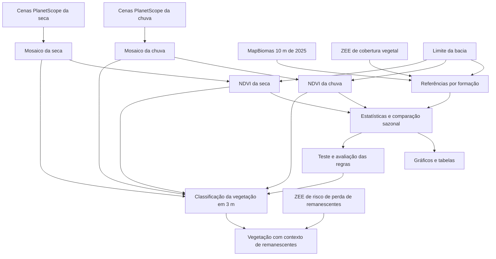

# Camadas de entrada e origem dos subprodutos

Esta documentação pertence à etapa Identificação → Uso do solo do planejamento de infraestrutura verde da Bacia do Paranoá. Seu objetivo é permitir que outra pessoa reconheça as entradas necessárias, acompanhe o processamento e identifique de quais dados cada resultado deriva.

A fonte adotada para a próxima etapa é a cópia local do MapBiomas identificada como produto de 10 m de 2025, conforme a decisão da autora. A coleção permanece sem comprovação nos metadados consultados. Não há dependência de download do MapBiomas para executar a exploração atual.

O objetivo em desenvolvimento é identificar e distinguir a vegetação na grade PlanetScope de 3 m. A definição dos componentes da rede de infraestrutura verde será tratada posteriormente.

## Atualização: fluxo vigente

A ordem adotada é **referências MapBiomas–ZEE → NDVI e exploração → quatro etapas de classificação/refinamento**, com o contexto dos remanescentes do ZEE-DF na etapa 4. Os cortes e o raster final estão em [FITOFISIONOMIA_3M.md](FITOFISIONOMIA_3M.md); o procedimento das referências está em [REFERENCIAS_E_NDVI.md](REFERENCIAS_E_NDVI.md). As tabelas de estados futuros abaixo registram o planejamento anterior e não descrevem o produto já publicado.

Os dois NDVIs integrais novos já foram gerados. A nova execução usa o **vetor MapBiomas**, cuja classe é `cod_sub`, e produziu interseções integrais para campestre, savânica, florestal e campo alagado/área pantanosa. O último grupo usa uma correspondência operacional confirmada com as áreas úmidas do ZEE; as definições não são idênticas. Pastagem é comparação apenas do MapBiomas, fora da rede de IV.

Os gráficos atuais usam esses novos NDVIs e interseções: distribuições por data e seca × chuva, sem cortes. O inventário JSON foi atualizado para os caminhos atuais, incluindo a nova pasta do raster MapBiomas. Os arquivos de execução histórica abaixo continuam preservados e não são os dados dos gráficos atuais.

**As seções seguintes documentam a primeira exploração amostral e seus estados à época.** Para gerar novamente os produtos vigentes, usar o novo procedimento vinculado acima, não a sequência histórica de reprodução abaixo.

## Camadas de entrada — exploração histórica

| Entrada | Data e resolução ou escala | Função | Situação |
| --- | --- | --- | --- |
| MapBiomas de uso e cobertura do solo | 2025; resolução nominal de 10 m; cópia local em coordenadas geográficas | Referência temática para cruzar com o ZEE e comparar classes | Disponível e usado na exploração; coleção a confirmar |
| PlanetScope do período chuvoso | 17/01/2026; mosaico de 3 m; oito bandas | Fonte espectral para calcular NDVI da chuva e apoiar a classificação | Disponível e usado na exploração |
| PlanetScope do período seco | 30/07/2026; mosaico de 3 m; oito bandas | Fonte espectral para calcular NDVI da seca e apoiar a classificação | Disponível e usado na exploração |
| ZEE-DF de cobertura vegetal | Vetor; data e escala da cópia precisam ser documentadas | Referência das formações campestre, savânica e florestal, por meio dos campos de classificação | Disponível e usado na exploração |
| ZEE-DF de risco de perda de remanescentes | Vetor; data e escala da cópia precisam ser documentadas | Identificar a condição de remanescente mapeado e a categoria de ausência de Cerrado nativo | Disponível; usado como contexto e grupo de comparação |
| Limite da Bacia do Paranoá | Vetor IPE-DF 2023, segundo a identificação do arquivo | Definir o recorte comum de todas as operações | Disponível e usado na exploração |
| Máscaras de qualidade das imagens, como UDM2 | Devem corresponder às cenas e datas utilizadas | Identificar nuvens, sombras e outras condições de qualidade antes das estatísticas | Não localizadas como arquivos separados; relatórios dos mosaicos informam que UDM2 não foi aplicado |

As duas camadas do ZEE têm funções diferentes. A camada de cobertura fornece as formações usadas nas referências; a camada de risco fornece a situação em relação aos remanescentes mapeados. A classe de ausência de Cerrado nativo não é, isoladamente, uma identificação de espécies exóticas.

O limite da bacia é necessário mesmo quando as entradas já foram recortadas: ele torna explícita a área analisada e evita comparar extensões diferentes.

## Resolução dos dados

- PlanetScope: grade de 3 m verificada nos dois mosaicos. As bandas Red e NIR estão identificadas como bandas 6 e 8.
- MapBiomas: produto de resolução nominal de 10 m. Consultar ou reamostrar suas classes sobre uma grade de 3 m não cria detalhe temático novo.
- ZEE-DF: polígonos vetoriais. A escala e a origem do levantamento precisam ser documentadas; não atribuir arbitrariamente uma resolução de 30 m.
- Primeira exploração estatística: seleciona pixels originais PlanetScope com espaçamento sistemático de 30 m. Esse espaçamento é da amostragem, não uma nova resolução da imagem nem da futura classificação.
- Produto de identificação pretendido: raster na grade PlanetScope de 3 m. Essa dimensão de célula não assegura acurácia temática ou posicional de 3 m.

## De quais entradas cada subproduto deriva

| Subproduto | Depende diretamente de | Operação | Estado nesta etapa |
| --- | --- | --- | --- |
| Mosaico PlanetScope da chuva | Cenas PlanetScope de janeiro | Mosaico e padronização espacial | Já existia; relatório registra 11 cenas |
| Mosaico PlanetScope da seca | Cenas PlanetScope de julho | Mosaico e padronização espacial | Já existia; relatório registra 7 cenas |
| NDVI da chuva | Mosaico da chuva, suas bandas Red/NIR e recorte da bacia | `(NIR − Red) / (NIR + Red)` | Recalculado nos pontos amostrais; novo raster integral ainda não produzido |
| NDVI da seca | Mosaico da seca, suas bandas Red/NIR e recorte da bacia | Mesma fórmula | Recalculado nos pontos amostrais; novo raster integral ainda não produzido |
| Referências por formação | MapBiomas, ZEE de cobertura vegetal e limite da bacia | Compatibilização temática e concordância espacial por formação | Calculadas nos centros amostrais; nova interseção vetorial integral ainda não gerada |
| Estatísticas e distribuições por formação | Referências por formação e valores de NDVI nas duas datas | Médias, medianas, dispersão, quantis e sobreposição das distribuições | Calculadas na exploração |
| Gráficos e tabelas da exploração | Amostras pareadas e estatísticas | Apresentação dos resultados descritivos | Gerados |
| Regras ou modelo de classificação | Distribuições, imagens e referências para avaliação | Teste e comparação de alternativas | Em definição; os cortes não foram fixados |
| Classificação da vegetação na grade de 3 m | Imagens PlanetScope, NDVI e regras ou modelo avaliados | Aplicação espacial da classificação | A produzir |
| Classificação com contexto de remanescentes | Classificação da vegetação e ZEE de risco de perda de remanescentes | Cruzamento espacial, preservando os atributos das duas etapas | A produzir após a classificação; nomenclatura final em discussão |

A média entre datas e a diferença sazonal são variáveis calculadas dentro da análise estatística de Referências + NDVI. Elas podem ajudar a comparar alternativas, mas não aparecem como subprodutos independentes no fluxo. Os NDVIs da seca e da chuva permanecem identificados separadamente.

As máscaras de qualidade, quando disponíveis, integram a preparação das imagens e afetam os pontos válidos de todos os subprodutos de NDVI. A exploração atual registra sua ausência como limitação.

## Fluxo de dependências



As setas representam dependência metodológica. Não significam que todas as etapas já foram executadas. O estado de cada produto consta na tabela anterior.

## Arquivos e reprodução

O inventário `camadas_identificacao.json`, nesta pasta, registra os arquivos relativos à raiz dos dados e as dependências dos produtos. O código lê as seis entradas desse inventário. A raiz é fornecida pelo argumento `--base` do programa; outro inventário pode ser indicado por `--camadas`. O arquivo JSON deve acompanhar o programa na distribuição.

Na exploração já executada, `resultados/resultados.json` registra os arquivos efetivamente lidos, seus hashes SHA-256, os parâmetros, as contagens e as limitações. Esse registro identifica uma execução específica; o inventário descreve a organização da metodologia.

As próximas execuções também registrarão a assinatura do inventário e as dependências dos produtos. Os resultados anteriores foram preservados como registro da execução já realizada.

Para executar a exploração com as entradas locais adotadas, usar Python/GDAL do QGIS:

```powershell
python analisar_vegetacao.py --base "CAMINHO/02 BASE DE DADOS" --out "NOVA_PASTA_RESULTADOS"
python apresentar_resultados.py "NOVA_PASTA_RESULTADOS"
```

Essa execução produz estatísticas amostrais e gráficos. A geração dos rasters integrais e da classificação final ainda será implementada. O módulo de download do MapBiomas é uma alternativa futura e não faz parte do caminho necessário desta execução.

## Organização no site

Destino: Identificação → Uso do solo. Seguir a organização de Riscos socioambientais:

1. Introdução com o objetivo da identificação.
2. Tabela de camadas de entrada, suas funções, datas, resoluções ou escalas e disponibilidade.
3. Produção do indicador, com o fluxo de dependências e o estado dos subprodutos.
4. Resultados, mapas e interpretação junto da etapa que os produziu.
5. Expansor “Ver procedimento completo”, fechado por padrão, com parâmetros, códigos, metadados, limitações e referências.

A tabela de entradas e o fluxo resumido devem ficar acessíveis antes do procedimento detalhado. Esta documentação acompanha a página de Uso do solo. A integração do PR e a publicação do site são etapas posteriores ao envio da branch.
